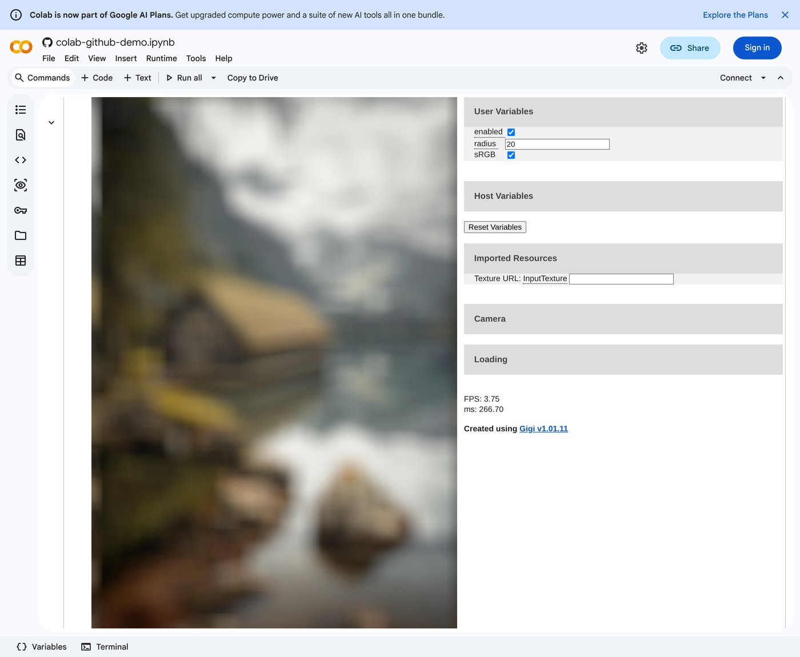

# colabgraphics

在 Google Colab 里学习和原型化实时图形算法的环境。出发点是把
[Gigi](https://github.com/electronicarts/gigi)（EA 的渲染技术快速原型工具）带到 Colab：
着色器和渲染图写在 notebook 单元格里，编译在 Colab 的 VM 里完成，渲染用 WebGPU 跑在读者自己的浏览器里。

当前阶段：**可行性验证完成，正式开发刚开始**。仓库里目前只有验证用的实验代码。



上图是真实的 Colab 页面：没有登录，没有连接运行时，单元格的输出是保存在 notebook 文件里的一段自包含 HTML，
其中的 Gigi 技术（boxblur）用 WebGPU 实时渲染。

## 架构

| 部件 | 在哪里运行 | 作用 |
|---|---|---|
| 编译器 | Colab VM | Linux 版 GigiCompiler + Slang，把 `.gg` 渲染图编译成 JS 模块和 WGSL |
| 参考执行器 | Colab VM | Node + Dawn + 软件 Vulkan 无头运行同一个模块：同步读回、断言、CI |
| 快照查看器 | 读者的浏览器 | `show()` 输出的自包含 HTML，存进 notebook，重开后不需要运行时 |
| 工作台 | 浏览器 ↔ VM | Gradio 式路径（VM 里的 HTTP 服务 + iframe）：改着色器、重编译、调试 |
| 调试层 | 两个执行器共用 | 包一层 WebGPU 的 encoder，以 Gigi 生成的调试组为节点边界做快照、计时、校验 |

## 已经实测的事实

Colab 前端（匿名打开真实 Colab，见 `experiments/colab-automation`）：

- 保存在 notebook 里的输出，重新打开时其中的 JavaScript 会再次执行；此时 `google.colab.kernel.accessAllowed` 为 `false`。
- WebGPU 在输出 iframe 里可用。
- 同一页面里所有单元格的输出 iframe 同源，可以互相调用；该域名每次打开页面都会变。
- 打开 notebook 时所有输出 iframe 立即创建，但只有可见的会收到动画帧。
- 单个 24 MB 的 HTML 输出可以渲染。同时带 HTML 和 PNG 的输出，Colab 显示 HTML。
- 输出 iframe 的 sandbox 不含 `allow-modals`，`allow` 为空，不能全屏；允许指针锁定和下载。

Colab VM（官方 [backend-info](https://github.com/googlecolab/backend-info)，2026-11-09）：

- Ubuntu 24.04.5，Python 3.13.18；gradio、anywidget 预装。
- apt 和 pip 清单里没有 Node，也没有 Vulkan 驱动。

内核侧执行器（无 GPU 的 Linux，Dawn 的 Node 绑定 + SwiftShader，见 `experiments/dawn-node`）：

- Gigi 自带的 50 个 WebGPU 测试中 47 个跑完；12 个与 gold 逐位一致，22 个最多差 2/255，13 个只在边缘像素有差异，3 个光追测试超时。
- 生成代码里有两处 Windows 路径习惯在 Linux 上失效（文件名大小写、`./assets/../x.png`），影响 11 个测试。

尚未在真实 Colab 里测过的：需要登录才能执行的部分，即内核与浏览器之间的通道
（`eval_js`、comm、端口代理）。`experiments/colab-probe/colab_probe.ipynb` 是为此准备的探针。

## 目录

```
experiments/
  colab-probe/        在 Colab 里手动运行的探针 notebook，及其本地排练
  colab-automation/   用 Playwright 匿名驱动真实 Colab；快照打包器 gigi_snapshot.py
  gradio-path/        Gradio 式路径的两个演示
  dawn-node/          用 Node + Dawn 无头运行 Gigi 的 WebGPU 测试
docs/images/          截图
```

## 复现实验

需要 Node、Playwright 自带的 Chromium，以及一份 Gigi 的检出（下面记作 `$GIGI`）。
WebGPU 在无 GPU 的机器上由 Chromium 自带的 SwiftShader 提供。

```bash
# 探针 notebook 的本地排练
cd experiments/colab-probe && python3 build.py && node test_local.cjs && python3 test_cells.py

# 匿名 Colab：保存的输出是否重新执行、WebGPU 是否可用
cd experiments/colab-automation && python3 build_saved_probe.py
node anon_saved.cjs saved_probe.ipynb /tmp/colab.png

# 把 Gigi 生成的应用打包成一段自包含输出，并放进真实 Colab
python3 gigi_snapshot.py $GIGI/_GeneratedCode/UnitTests/WebGPU UnitTests/Compute/boxblur /tmp/boxblur.html
node anon_gigi.cjs /tmp/boxblur.html /tmp/colab_gigi.png

# 用 Node + Dawn 无头运行 Gigi 的 WebGPU 测试（先在测试根目录 npm install webgpu pngjs）
python3 experiments/dawn-node/run_gigi_tests.py $GIGI/_GeneratedCode/UnitTests/WebGPU \
    /path/to/chrome-linux64/vk_swiftshader_icd.json
```

`anon_*.cjs` 的做法：打开 Colab 的 GitHub notebook 地址，在浏览器里拦截它取 `.ipynb` 的请求，
用本地文件作答。这样不需要发布任何东西，也不需要登录。
