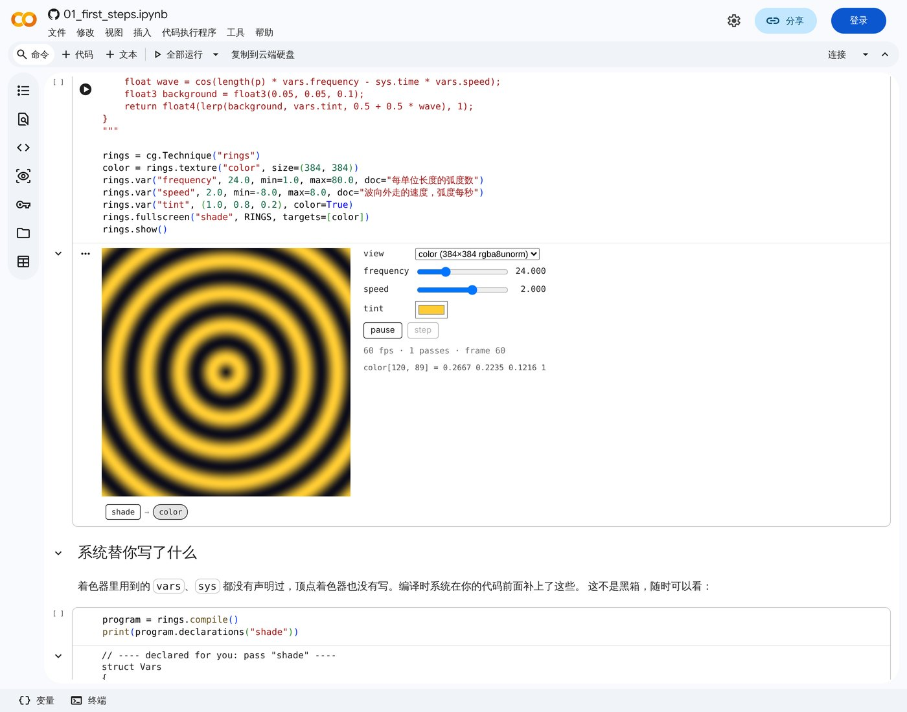

# colabgraphics

在 Google Colab 里学习和原型化实时图形算法的环境。

它是一个 Colab 原生的项目，**设计上借鉴** [Gigi](https://github.com/electronicarts/gigi)
（EA 的渲染技术快速原型工具）的交互体验和编译器做法，但不运行 Gigi 本身，也不依赖它的编译器：
作者只描述"有哪些纹理、哪些变量、依次跑哪些 pass"并写着色器的算法部分，
资源创建、绑定、管线、每帧调度、变量界面这些样板由系统生成。
描述和着色器写在 notebook 单元格里，渲染用 WebGPU 跑在读者自己的浏览器里。

| notebook | 内容 | |
|---|---|---|
| 第一步 | 三角形、变量、两个 pass 的模糊、用 numpy 核对 | [](https://colab.research.google.com/github/x380kkm/colabgraphics/blob/dev/notebooks/01_first_steps.ipynb) |
| 第二步 | Blender 管场景和相机，自己的着色器渲染，与 Blender 的答案核对 | [](https://colab.research.google.com/github/x380kkm/colabgraphics/blob/dev/notebooks/02_blender_scene.ipynb) |



上图是真实的 Colab 页面：没有登录，没有连接运行时。画面随 notebook 文件保存，打开就在读者的浏览器里渲染。

## 写起来是什么样

```python
import colabgraphics as cg

BLUR = """
@compute @workgroup_size(8, 8)
fn main(@builtin(global_invocation_id) id: vec3u) {
  let p = vec2i(id.xy);
  let size = vec2i(textureDimensions(image));
  var sum = vec4f(0);
  for (var i = -vars.radius; i <= vars.radius; i++) {
    sum += textureLoad(image, clamp(p + i * DIR, vec2i(0), size - 1), 0);
  }
  textureStore(result, p, sum / f32(2 * vars.radius + 1));
}
"""

t = cg.Technique("boxblur")
src = t.image("src", picture)                 # 一张 numpy 图片
tmp = t.texture("tmp", like=src)              # 尺寸和格式跟随 src
out = t.texture("out", like=src)
t.var("radius", 6, min=0, max=32)             # 画面旁边自动出现滑块

t.compute("blur_h", "const DIR = vec2i(1, 0);" + BLUR, reads={"image": src}, writes={"result": tmp})
t.compute("blur_v", "const DIR = vec2i(0, 1);" + BLUR, reads={"image": tmp}, writes={"result": out})

t.show()                # 活的画面，存进 notebook
t.read(out, radius=4)   # 无头执行，返回 numpy 数组，用于断言
```

着色器里的 `image`、`result`、`vars` 都不用声明：编译器按 `reads=`、`writes=` 和 `var()` 生成声明，
`t.compile().wgsl("blur_h")` 可以看到完整结果。

## 现在有什么

| 部件 | 状态 |
|---|---|
| 技术描述与编译器（`technique.py`） | 纹理、变量、compute pass、draw pass；生成绑定声明和 `vars` 结构体；错误信息指明 pass 和原因 |
| 运行时（`js/runtime.js`） | 同一个文件在浏览器和 Node + Dawn 下运行 |
| 查看器（`js/viewer.js`、`display.py`） | 自包含 HTML 输出；每个变量一个控件；pass 流程条，点纹理名看中间结果 |
| 无头执行（`headless.py`） | `read()` 返回 numpy；着色器报错指回作者的行号 |
| Blender 桥（`blender.py`） | 场景取成数组（三角形、材质颜色、相机矩阵、灯光）；Blender 的光线求交给出深度与覆盖的参考；Cycles 渲染参考图 |
| 测试 | 浏览器与无头两条路径都和 numpy 参考实现比对；光栅化结果与 Blender 的光线求交比对；另有针对真实 Colab 前端的检查 |

查看器里可以点纹理名看任意一步的结果、悬停读像素数值、暂停和单步。

还没有的：采样器之外的资源类型（缓冲、三维纹理）、在画面里用鼠标转动相机、贴图材质、
逐 pass 的时间线快照、计时、内核连着时的实时工作台、图片的压缩存储。

## Blender 负责场景和相机

Blender 作为 Python 模块（`pip install bpy`）跑在 notebook 的运行时里，没有窗口。

```python
from colabgraphics import blender

blender.demo_scene()                      # 或者 blender.open("我的场景.blend")
data = blender.scene(resolution=(512, 384))

t = cg.Technique("scene")
color = t.texture("color", size=data.resolution)
mesh = t.mesh("scene", data.positions, data.normals, data.uvs, data.colors)
t.var("view_projection", data.camera.view_projection)
t.draw("raster", SHADER, targets=[color], mesh=mesh, depth=True)

ref = blender.reference()                 # 每个像素该看到什么：深度、覆盖、法线
picture = blender.render(samples=48)      # Cycles 对同一场景的渲染
```

矩阵按 WebGPU 的约定给出（深度范围 0 到 1）。在测试场景上，光栅化的覆盖范围与 Blender 光线求交的
交并比为 0.9998，深度的中位误差约 5e-5 个场景单位。

## 架构

| 部件 | 在哪里运行 | 作用 |
|---|---|---|
| 技术描述 | notebook 单元格 | 用 Python 声明资源、变量和 pass；着色器用 WGSL 只写算法部分 |
| 编译器 | Colab VM（Python） | 校验描述，为着色器生成绑定声明和变量结构体，产出给运行时执行的程序（JSON） |
| 运行时 | 浏览器，以及 VM 里的无头环境 | 同一份程序在读者的 GPU 上实时运行，也能在 VM 里无头运行以便读回、断言和 CI |
| 快照查看器 | 读者的浏览器 | `show()` 输出的自包含 HTML，存进 notebook，重开后不需要运行时 |
| 工作台（未实现） | 浏览器 ↔ VM | Gradio 式路径（VM 里的 HTTP 服务 + iframe）：改着色器、重编译、调试 |
| 调试层（未实现） | 运行时内 | 每个 pass 之后的资源快照、像素探针、计时 |

## 已经实测的事实

Colab 前端（匿名打开真实 Colab，见 `experiments/colab-automation`）：

- 保存在 notebook 里的输出，重新打开时其中的 JavaScript 会再次执行；此时 `google.colab.kernel.accessAllowed` 为 `false`。
- WebGPU 在输出 iframe 里可用。
- 同一页面里所有单元格的输出 iframe 同源，可以互相调用；该域名每次打开页面都会变。
- 打开 notebook 时所有输出 iframe 立即创建，但只有可见的会收到动画帧。
- 单个 24 MB 的 HTML 输出可以渲染。同时带 HTML 和 PNG 的输出，Colab 显示 HTML。
- 输出 iframe 的 sandbox 不含 `allow-modals`，`allow` 为空，不能全屏；允许指针锁定和下载。

Colab VM（官方 [backend-info](https://github.com/googlecolab/backend-info)，2026-11-09）：

- Ubuntu 24.04.5，Python 3.13.18；gradio、anywidget 预装。
- apt 和 pip 清单里没有 Node，也没有 Vulkan 驱动。

无头运行 WebGPU（无 GPU 的 Linux，Dawn 的 Node 绑定，见 `experiments/dawn-node`）：

- 默认找不到 Vulkan 驱动；指向 SwiftShader 后可用，得到完整的 WebGPU 核心功能。
- 不装任何 Vulkan 驱动也行：Dawn 的 OpenGL ES 后端可以跑在 Mesa 的软件渲染上（需要让 `libEGL.so` 这个名字能被找到），
  得到的是 WebGPU 兼容模式，功能少一些。Colab 镜像预装了所需的 Mesa 包；这一点还没在 Colab 的 VM 里实测。
- 作为负载，Gigi 自带的 50 个 WebGPU 测试中 47 个跑完；12 个与 gold 逐位一致，22 个最多差 2/255，
  13 个只在边缘像素有差异，3 个光追测试超时。所以跨实现的结果比较必须用容差。
- Node 可以用 pip 装（PyPI 上的 `nodejs-wheel-binaries`）。

Blender（同一台 Linux，Python 3.13）：

- PyPI 上的 `bpy` 5.2.3 要求的 Python 版本正是 3.13，与 Colab 当前版本一致；安装约 40 秒，下载 403 MB。
- 无头工作正常：建场景、取网格和相机数据、Cycles 用 CPU 渲染。还没在 Colab 的 VM 里实测。
- `bpy` 只支持与 Blender 自带版本相同的 Python。Colab 升级 Python 后可能有一段时间装不上，
  届时的退路是下载 Blender 压缩包并以子进程方式调用。

尚未在真实 Colab 里测过的，都是需要登录才能执行的部分：

- `read()` 的无头执行在 Colab 的 VM 里能否直接工作（那里没有 Node，驱动只有 Mesa 的 OpenGL ES）。
- `pip install bpy` 之后 Blender 在 Colab 的 VM 里能否直接导入和渲染。
- 内核与浏览器之间的通道（`eval_js`、comm、端口代理）。`experiments/colab-probe/colab_probe.ipynb` 是为此准备的探针。

## 目录

```
src/colabgraphics/    Python 包：technique.py（描述与编译）、display.py、headless.py、js/（运行时与查看器）
notebooks/            notebook；src/ 下是它们的源文件，由 tools/build_notebook.py 生成带输出的 .ipynb
examples/             单文件示例
tests/                端到端测试
tools/remote-browser/ 在无头机器上让人手动操作浏览器的远程画面
experiments/          可行性验证阶段的实验（Colab 探针、匿名驱动 Colab、Gradio 式路径、Dawn 无头）
docs/images/          截图
```

## 开发

需要 Node 和 Playwright 自带的 Chromium；没有 GPU 的机器上，WebGPU 由 Chromium 自带的 SwiftShader 提供。

```bash
# 端到端测试：Python 描述 -> 浏览器或无头执行 -> 与 numpy 比对
PYTHONPATH=src python3 tests/test_techniques.py
PYTHONPATH=src python3 tests/test_blender.py        # 需要 pip install bpy

# 重新生成 notebook（会执行其中的代码并保存输出）
PYTHONPATH=src python3 tools/build_notebook.py notebooks/src/01_first_steps.py notebooks/01_first_steps.ipynb

# 在真实的 Colab 前端里检查 notebook 的每个画面（匿名，不需要运行时）
node tests/colab_open.cjs \
  "https://colab.research.google.com/github/x380kkm/colabgraphics/blob/dev/notebooks/01_first_steps.ipynb" /tmp/nb
```

`experiments/` 里各实验的用法见各自文件开头的注释。
